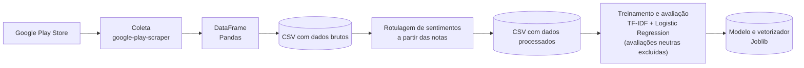
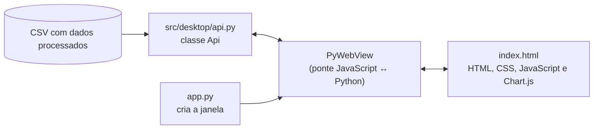

# DeliveryLens AI

Aplicação para análise de avaliações de aplicativos de delivery, utilizando Ciência de Dados, Processamento de Linguagem Natural (NLP) e Machine Learning, com uma interface desktop para visualização dos resultados.

> **Status:** versão 1.1 (experimental). O projeto está em desenvolvimento e não deve ser considerado um produto finalizado ou pronto para produção.

---

## Sumário

- [Visão geral](#visão-geral)
- [Novidades da versão 1.1](#novidades-da-versão-11)
- [Fluxo de funcionamento](#fluxo-de-funcionamento)
- [Ciência de Dados e Machine Learning](#ciência-de-dados-e-machine-learning)
- [Resultados experimentais](#resultados-experimentais)
- [Aplicação desktop](#aplicação-desktop)
- [Tecnologias](#tecnologias)
- [Uso do aplicativo no Windows](#uso-do-aplicativo-no-windows)
- [Execução em ambiente de desenvolvimento](#execução-em-ambiente-de-desenvolvimento)
- [Estrutura do projeto](#estrutura-do-projeto)
- [Limitações](#limitações)
- [Melhorias futuras](#melhorias-futuras)
- [Observações sobre os dados](#observações-sobre-os-dados)

---

## Visão geral

O DeliveryLens AI analisa avaliações públicas de aplicativos de delivery disponibilizadas na Google Play Store. O projeto reúne duas partes:

1. **Pipeline de Ciência de Dados e Machine Learning:** coleta as avaliações, rotula os sentimentos a partir das notas, e treina e avalia um classificador de sentimento.
2. **Aplicação desktop:** exibe indicadores e gráficos calculados a partir dos dados processados, em uma janela construída com PyWebView.

| Item | Descrição |
| --- | --- |
| Versão | 1.1 (experimental) |
| Aplicativos analisados | iFood e Rappi |
| Fonte dos dados | Avaliações públicas da Google Play Store |
| Representação textual | TF-IDF |
| Classificador | Logistic Regression (classificação binária: negativo e positivo) |
| Interface | Aplicação desktop com HTML, CSS, JavaScript e PyWebView |
| Distribuição para Windows | ZIP com o aplicativo empacotado pelo PyInstaller (formato `onedir`) |

---

## Novidades da versão 1.1

A versão anterior continha o pipeline de coleta, rotulagem e treinamento. A versão 1.1 mantém esse pipeline e adiciona:

- Uma **aplicação desktop** para visualização dos dados processados, com indicadores, gráficos, alternância entre iFood e Rappi e alternância entre tema claro e escuro.
- Uma **API em Python** (`src/desktop/api.py`) que fornece os dados para a interface por meio do PyWebView.
- Um **executável para Windows**, gerado com PyInstaller no formato `onedir` e distribuído em um arquivo ZIP na seção de Releases.

---

## Fluxo de funcionamento

### Pipeline de dados e treinamento



### Aplicação desktop



O dashboard consulta o CSV processado. Ele **não** executa coleta em tempo real e, na versão atual, **não** utiliza o modelo treinado para exibir predições.

---

## Ciência de Dados e Machine Learning

### Fonte e escopo

Os dados são avaliações públicas dos aplicativos **iFood** e **Rappi** na Google Play Store, coletadas com a biblioteca `google-play-scraper`.

### Etapas do pipeline

1. Coleta de avaliações.
2. Conversão dos registros em DataFrame (Pandas).
3. Armazenamento dos dados brutos em CSV.
4. Rotulagem de sentimentos a partir das notas.
5. Armazenamento dos dados processados.
6. Treinamento e avaliação do modelo.
7. Persistência dos artefatos (modelo e vetorizador) com Joblib.

### Rotulagem de sentimentos

Os rótulos são derivados **exclusivamente da nota** da avaliação. Não houve anotação manual.

| Nota | Rótulo |
| --- | --- |
| 1 e 2 | Negativo |
| 3 | Neutro |
| 4 e 5 | Positivo |

As avaliações neutras são excluídas do treinamento do classificador binário.

### Coleta e quantidade de avaliações

A coleta está configurada com limite máximo de **500 avaliações por aplicativo**, em páginas de 10 avaliações.

Esse limite **não garante** a obtenção de exatamente 500 avaliações: a quantidade efetivamente coletada depende da disponibilidade retornada pela Google Play.

Na execução utilizada para a versão 1.1, foram obtidas:

| Aplicativo | Avaliações coletadas |
| --- | --- |
| iFood | 440 |
| Rappi | 500 |
| **Total** | **940** |

### Modelo

- Representação textual com **TF-IDF**.
- Classificação com **Logistic Regression** (Scikit-learn).
- Persistência do modelo e do vetorizador com **Joblib**.
- Classificação binária (negativo e positivo) no treinamento atual.

---

## Resultados experimentais

O último treinamento apresentou **acurácia de 92%** em um conjunto de teste com **184 amostras**.

| Classe | Precision | Recall | F1-score | Support |
| --- | --- | --- | --- | --- |
| Negativo | 0.91 | 0.95 | 0.93 | 92 |
| Positivo | 0.94 | 0.90 | 0.92 | 92 |

> **Interpretação dos resultados**
>
> Esses números pertencem a **uma execução experimental específica**. Eles não representam desempenho garantido e **não devem ser interpretados como prova de generalização** do modelo. Pontos a considerar:
>
> - Os rótulos são derivados das notas, sem anotação manual; uma nota pode não refletir o sentimento expresso no texto.
> - A amostra é pequena (940 avaliações coletadas, de dois aplicativos).
> - Não há validação externa com um conjunto de dados independente.
> - Uma nova execução do pipeline coleta avaliações diferentes e pode produzir métricas diferentes.

---

## Aplicação desktop

A aplicação desktop é a principal novidade da versão 1.1.

### Arquitetura

- **Interface:** HTML, CSS e JavaScript (`index.html`), com gráficos em Chart.js.
- **Camada de processamento e acesso aos dados:** Python (`src/desktop/api.py`).
- **Janela desktop:** PyWebView, que executa a interface em uma janela nativa.
- **Comunicação:** o JavaScript chama métodos Python por meio da API disponibilizada pelo PyWebView.

### Arquivos principais

| Arquivo | Responsabilidade |
| --- | --- |
| `app.py` | Ponto de entrada. Cria a janela do aplicativo e disponibiliza a classe `Api` para o frontend. |
| `src/desktop/api.py` | Define a classe `Api`, que consulta o CSV processado e retorna os dados à interface. |
| `index.html` | Interface do dashboard (estrutura, estilos e lógica em JavaScript). |

### API Python

| Método | Retorno |
| --- | --- |
| `obter_indicadores(app_id)` | Quantidade de avaliações, positivas, negativas, neutras e a nota média do aplicativo informado. |
| `obter_avaliacoes_por_dia(app_id)` | Quantidade de avaliações agrupadas por data. |

### Recursos da interface

- Indicador de quantidade total de avaliações.
- Indicador de quantidade de avaliações positivas.
- Indicador de quantidade de avaliações negativas.
- Indicador de nota média.
- Gráfico de rosca com a distribuição dos sentimentos.
- Gráfico de linha com a quantidade de avaliações por data.
- Alternância entre **iFood** e **Rappi**.
- Alternância entre tema **claro** e **escuro**.

### Origem dos dados e escopo

- Os dados exibidos são **consultados a partir do CSV processado**. O aplicativo **não executa coleta em tempo real**.
- Os sentimentos exibidos correspondem aos rótulos presentes nos dados processados, derivados das notas (veja [Rotulagem de sentimentos](#rotulagem-de-sentimentos)).
- O seletor de período presente na interface **ainda não filtra os dados**; a funcionalidade não foi implementada.
- A interface **não oferece predição de sentimento em tempo real**; essa funcionalidade não está integrada ao dashboard atual.

---

## Tecnologias

### Ciência de Dados e Machine Learning

| Tecnologia | Uso no projeto |
| --- | --- |
| Python | Linguagem utilizada no pipeline e na camada de processamento da aplicação. |
| google-play-scraper | Coleta das avaliações na Google Play Store. |
| Pandas | Manipulação dos dados e conversão dos registros em DataFrame. |
| Scikit-learn | Treinamento e avaliação do classificador. |
| TF-IDF | Representação numérica dos textos das avaliações. |
| Logistic Regression | Classificação binária de sentimento. |
| Joblib | Persistência do modelo e do vetorizador. |

### Aplicação desktop

| Tecnologia | Uso no projeto |
| --- | --- |
| Python | Camada de processamento e acesso aos dados (`app.py` e `src/desktop/api.py`). |
| PyWebView | Executa a interface em uma janela desktop e expõe a classe `Api` ao JavaScript. |
| HTML | Estrutura da interface. |
| CSS | Estilos da interface, incluindo os temas claro e escuro. |
| JavaScript | Lógica da interface e comunicação com a API Python. |
| Chart.js | Gráficos de rosca e de linha. |
| PyInstaller | Empacotamento da aplicação para Windows no formato `onedir`. |

> As versões das bibliotecas Python utilizadas estão declaradas em [`requirements.txt`](requirements.txt), que é a referência para o ambiente de desenvolvimento.

---

## Uso do aplicativo no Windows

Esta seção é destinada a quem deseja **apenas executar o programa**, sem instalar o Python e sem acessar o código.

### Requisitos

- Windows 10 ou 11 (64 bits). <!-- VERIFICAR: confirmar a arquitetura e as versões do Windows em que o executável foi testado. -->
- **Microsoft Edge WebView2 Runtime.** O PyWebView utiliza esse componente para exibir a interface. Ele não faz parte do ZIP do aplicativo. Em muitas instalações do Windows ele já está presente; caso a janela não abra, instale-o pelo [site oficial da Microsoft](https://developer.microsoft.com/microsoft-edge/webview2/). <!-- VERIFICAR: confirmar que o runtime não está incluído na distribuição. -->
- Conexão com a internet, caso a interface carregue recursos externos. Veja a nota abaixo.

> **Sobre a conexão com a internet**
>
> O aplicativo consulta dados locais e não realiza coleta. No entanto, a interface pode carregar recursos externos (como a biblioteca Chart.js ou fontes), dependendo de como foram referenciados em `index.html`. Nesse caso, sem conexão, os gráficos ou o visual da interface podem não ser exibidos corretamente.
> <!-- VERIFICAR: conferir em index.html se Chart.js e fontes são carregados por CDN ou localmente. Se forem locais, substituir esta nota por: "O aplicativo funciona sem conexão com a internet." Se forem por CDN, afirmar diretamente que a conexão é necessária. -->

### Passo a passo

1. Acesse a seção [**Releases**](https://github.com/Miguellsouza/DeliveryLens-AI/releases) do repositório no GitHub.
2. Baixe o arquivo ZIP da **versão 1.1**.
3. Extraia o ZIP para uma pasta do computador.
4. Abra a pasta **`DeliveryLensAI`** extraída.
5. Execute **`DeliveryLensAI.exe`**.
6. Aguarde a inicialização da janela do aplicativo.

### Avisos importantes

- **Não extraia nem copie somente o arquivo `.exe`.** O executável depende dos arquivos presentes na pasta `_internal`, que deve permanecer ao lado dele.
- Extraia o ZIP **completo** antes de executar; não execute o programa de dentro do visualizador de ZIP.
- Você **não precisa executar `app.py`**.
- Você **não precisa instalar o Python** para usar a versão empacotada.
- A distribuição atual é um ZIP com o aplicativo no formato `onedir`. **Não há instalador.**

Estrutura esperada após a extração:

```text
DeliveryLensAI/
├── DeliveryLensAI.exe
└── _internal/
```

O executável original, após a compilação, encontra-se em `dist/DeliveryLensAI/DeliveryLensAI.exe`.

### Solução de problemas

| Sintoma | Possível causa e ação |
| --- | --- |
| A janela não abre ou aparece em branco | O WebView2 Runtime pode não estar instalado. Instale-o pelo link indicado nos requisitos. |
| Mensagem de arquivo ou biblioteca ausente | Verifique se a pasta `_internal` está ao lado do `.exe` e se o ZIP foi extraído por completo. |
| O Windows exibe um aviso de segurança ao abrir | Executáveis gerados com PyInstaller e sem assinatura digital podem acionar o Windows SmartScreen ou antivírus. Baixe o arquivo apenas da seção Releases deste repositório. |

---

## Execução em ambiente de desenvolvimento

Esta seção é destinada a desenvolvedores que desejam executar o código-fonte, reproduzir o pipeline ou modificar o projeto.

### Pré-requisitos

- Python instalado e disponível no `PATH`.
- Git.
- Conexão com a internet (necessária para instalar as dependências e para a coleta de avaliações).

### Comandos

Execute todos os comandos **a partir da raiz do projeto**. Os comandos abaixo são para Windows/PowerShell.

```powershell
git clone https://github.com/Miguellsouza/DeliveryLens-AI.git

cd DeliveryLens-AI

python -m venv .venv

.\.venv\Scripts\Activate.ps1

pip install -r requirements.txt

python run_pipeline.py

python app.py
```

| Comando | O que faz |
| --- | --- |
| `git clone ...` | Clona o repositório. |
| `cd DeliveryLens-AI` | Acessa a raiz do projeto. |
| `python -m venv .venv` | Cria o ambiente virtual. |
| `.\.venv\Scripts\Activate.ps1` | Ativa o ambiente virtual. |
| `pip install -r requirements.txt` | Instala as dependências. |
| `python run_pipeline.py` | Executa uma **nova coleta**, processa os dados e **treina novamente** o modelo. |
| `python app.py` | Abre a aplicação desktop. |

### Observações

- **Execute o pipeline antes de abrir o dashboard.** Os diretórios de dados estão ignorados pelo Git e, portanto, não são disponibilizados em um clone comum do repositório. Sem executar `run_pipeline.py`, a aplicação não terá o CSV processado para consultar.
- O pipeline **exige conexão com a internet**, pois realiza a coleta na Google Play Store.
- A coleta pode retornar uma **quantidade variável de avaliações**. Os dados e as métricas obtidos em uma nova execução podem diferir dos apresentados neste README.
- Se o PowerShell bloquear a ativação do ambiente virtual por política de execução, é possível liberar a execução apenas para a sessão atual com `Set-ExecutionPolicy -Scope Process -ExecutionPolicy Bypass`.

---

## Estrutura do projeto

<!-- VERIFICAR: comparar esta árvore com a estrutura real (por exemplo, com o comando `tree /F`) e ajustar os nomes das pastas de dados e artefatos, dos arquivos SVG e dos módulos dentro de src/data e src/models. -->

```text
DeliveryLens-AI/
├── app.py                  # Ponto de entrada da aplicação desktop
├── index.html              # Interface do dashboard
├── run_pipeline.py         # Executa coleta, processamento e treinamento
├── requirements.txt        # Dependências Python
├── DeliveryLensAI.spec     # Configuração do PyInstaller
├── <arquivos>.svg          # Arquivos SVG utilizados na interface
├── src/
│   ├── desktop/
│   │   └── api.py          # Classe Api exposta ao JavaScript via PyWebView
│   ├── data/               # Módulos de coleta e processamento dos dados
│   └── models/             # Módulos de treinamento, avaliação e persistência do modelo
├── <pastas de dados>/      # CSVs brutos e processados (ignorados pelo Git)
├── <pasta de artefatos>/   # Modelo e vetorizador gerados pelo pipeline
├── build/                  # Gerado pelo PyInstaller (ignorado pelo Git)
└── dist/                   # Gerado pelo PyInstaller (ignorado pelo Git)
```

### Responsabilidades

| Caminho | Responsabilidade |
| --- | --- |
| `app.py` | Cria a janela do aplicativo com PyWebView e disponibiliza a classe `Api`. |
| `index.html` | Interface do dashboard: indicadores, gráficos, alternância de aplicativo e de tema. |
| `src/desktop/api.py` | Métodos `obter_indicadores` e `obter_avaliacoes_por_dia`, que consultam o CSV processado. |
| `src/data/` | Coleta das avaliações, conversão em DataFrame, armazenamento em CSV e rotulagem. |
| `src/models/` | Treinamento, avaliação e persistência do modelo e do vetorizador. |
| `run_pipeline.py` | Orquestra as etapas do pipeline de dados e treinamento. |
| `requirements.txt` | Lista as dependências Python e suas versões. |
| `DeliveryLensAI.spec` | Define como o PyInstaller empacota a aplicação. |
| `build/` e `dist/` | Diretórios gerados pelo PyInstaller. Estão ignorados pelo Git e não fazem parte do código-fonte. |

---

## Limitações

As limitações abaixo se referem ao estado **atual** do projeto.

**Ciência de Dados e Machine Learning**

- O treinamento atual é de **classificação binária**; as avaliações neutras são descartadas.
- Os rótulos são **derivados das notas**, sem anotação manual.
- A **generalização é limitada**; os resultados refletem uma execução específica.
- Não há **validação externa** com um conjunto de dados independente.
- A base de avaliações é pequena e restrita a dois aplicativos, sendo necessário ampliá-la e diversificá-la.
- Não há **análise automática aprofundada das causas das reclamações**.

**Aplicação desktop**

- O **seletor de período não filtra** os dados.
- O dashboard não exibe predições do modelo; consulta apenas o CSV processado.
- A interface e a experiência de uso precisam de melhorias.
- Os testes da aplicação são insuficientes e precisam ser ampliados.
- A arquitetura e a distribuição do aplicativo precisam ser aprimoradas (a distribuição atual é um ZIP, sem instalador).

---

## Melhorias futuras

As melhorias abaixo são **planejadas ou sugeridas** e **ainda não foram implementadas**.

- Implementar classificação em três categorias (negativo, neutro e positivo).
- Identificar os motivos de insatisfação nas avaliações.
- Aumentar e diversificar a base de dados.
- Experimentar outros modelos de NLP.
- Melhorar a validação e a avaliação do modelo.
- Implementar filtros por período no dashboard.
- Melhorar o dashboard.
- Aprimorar a distribuição da aplicação desktop.
- Criar testes automatizados.

---

## Observações sobre os dados

O projeto utiliza avaliações publicamente disponíveis na Google Play Store para fins de análise. Os nomes iFood, Rappi e Google Play pertencem aos respectivos titulares.
