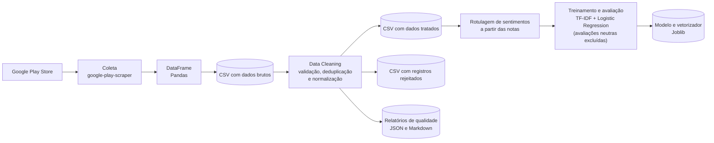
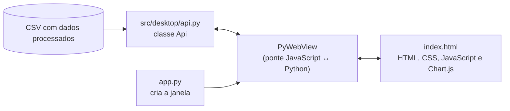

DeliveryLens AI
Aplicação para análise de avaliações de aplicativos de delivery, utilizando Ciência de Dados, Processamento de Linguagem Natural (NLP) e Machine Learning, com uma interface desktop para visualização dos resultados.
> **Status:** versão 1.1 (experimental). O projeto está em desenvolvimento e não deve ser considerado um produto finalizado ou pronto para produção.
---
Sumário
Visão geral
Novidades da versão 1.1
Fluxo de funcionamento
Ciência de Dados e Machine Learning
Resultados experimentais
Aplicação desktop
Tecnologias
Uso do aplicativo no Windows
Execução em ambiente de desenvolvimento
Estrutura do projeto
Limitações
Melhorias futuras
Observações sobre os dados
---
Visão geral
O DeliveryLens AI analisa avaliações públicas de aplicativos de delivery disponibilizadas na Google Play Store. O projeto continua experimental e em desenvolvimento e reúne duas partes:
Pipeline de Ciência de Dados e Machine Learning: coleta as avaliações, trata e valida os dados (Data Cleaning), rotula os sentimentos a partir das notas, e treina e avalia um classificador de sentimento.
Aplicação desktop: exibe indicadores e gráficos calculados a partir dos dados processados, em uma janela construída com PyWebView.
Item	Descrição
Versão	1.1 (experimental)
Aplicativos analisados	iFood e Rappi
Fonte dos dados	Avaliações públicas da Google Play Store
Armazenamento	Arquivos CSV
Tratamento dos dados	Data Cleaning: validação, deduplicação, normalização e relatórios de qualidade
Representação textual	TF-IDF
Classificador	Logistic Regression (classificação binária: negativo e positivo)
Interface	Aplicação desktop com HTML, CSS, JavaScript e PyWebView
Distribuição para Windows	ZIP com o aplicativo empacotado pelo PyInstaller (formato `onedir`)
---
Novidades da versão 1.1
A versão anterior continha o pipeline de coleta, rotulagem e treinamento. A versão 1.1 mantém esse pipeline e adiciona:
Uma aplicação desktop para visualização dos dados processados, com indicadores, gráficos, alternância entre iFood e Rappi e alternância entre tema claro e escuro.
Uma API em Python (`src/desktop/api.py`) que fornece os dados para a interface por meio do PyWebView.
Um executável para Windows, gerado com PyInstaller no formato `onedir` e distribuído em um arquivo ZIP na seção de Releases.
Evolução do pipeline de dados
O número de versão acima (1.1) refere-se ao aplicativo desktop. O pipeline de dados evoluiu desde a versão inicial do projeto e, no código-fonte atual, inclui:
Uma etapa de Data Cleaning (validação, deduplicação, normalização e relatórios de qualidade), descrita em Data Cleaning.
Processamento de uma base local de 20.000 avaliações na execução mais recente.
Testes automatizados do módulo de limpeza.
A opção `--skip-collect` do `run_pipeline.py`, que reaproveita os dados brutos existentes.
Os números e resultados deste README referem-se à execução mais recente do pipeline em ambiente de desenvolvimento e não correspondem, necessariamente, aos dados empacotados no aplicativo distribuído.
---
Fluxo de funcionamento
Pipeline de dados e treinamento

A etapa de Data Cleaning produz os dados tratados, o arquivo de registros rejeitados e os relatórios de qualidade (veja Data Cleaning).
O `run_pipeline.py` com a opção `--skip-collect` não realiza nova coleta: ele processa os dados brutos já existentes localmente. Veja Execução em ambiente de desenvolvimento.
Aplicação desktop

O dashboard consulta o CSV processado. Ele não executa coleta em tempo real e, na versão atual, não utiliza o modelo treinado para exibir predições.
Processamento, treinamento e dashboard
Estas são etapas distintas:
Processamento: coleta (opcional) e Data Cleaning, que geram os dados tratados.
Treinamento: rotulagem, treinamento e avaliação do classificador, com persistência do modelo e do vetorizador.
Dashboard: `app.py`, executado separadamente, que apenas consulta os dados já gerados.
O `run_pipeline.py` executa o processamento e o treinamento.
---
Ciência de Dados e Machine Learning
Fonte e escopo
Os dados são avaliações públicas dos aplicativos iFood e Rappi na Google Play Store, coletadas com a biblioteca `google-play-scraper`.
Etapas do pipeline
Coleta de avaliações.
Conversão dos registros em DataFrame (Pandas).
Armazenamento dos dados brutos em CSV.
Data Cleaning: validação, deduplicação e normalização dos dados brutos (veja Data Cleaning).
Armazenamento dos dados tratados, dos registros rejeitados e dos relatórios de qualidade.
Rotulagem de sentimentos a partir das notas.
Treinamento e avaliação do modelo.
Persistência dos artefatos (modelo e vetorizador) com Joblib.
Rotulagem de sentimentos
Os rótulos são derivados exclusivamente da nota da avaliação. Não houve anotação manual.
Nota	Rótulo
1 e 2	Negativo
3	Neutro
4 e 5	Positivo
As avaliações neutras são excluídas do treinamento do classificador binário.
Coleta e quantidade de avaliações
O limite máximo de avaliações por aplicativo é definido na implementação da coleta (`src/data/`).
Esse limite é um teto e não garante a obtenção da quantidade configurada: a quantidade efetivamente coletada depende da disponibilidade retornada pela Google Play e pode variar entre execuções.
Na execução mais recente, o pipeline processou uma base local de 20.000 avaliações:
Aplicativo	Avaliações
iFood	10.000
Rappi	10.000
Total	20.000
Esses valores descrevem uma execução específica e não são garantia de futuras coletas.
> **Disponibilidade dos dados locais**
>
> Os arquivos de dados locais (brutos e processados) são ignorados pelo Git e, por isso, não são necessariamente disponibilizados em um clone comum do repositório. Para reproduzir os resultados, é necessário executar o pipeline localmente.
Data Cleaning
A etapa de Data Cleaning trata e valida os dados brutos antes da rotulagem e do treinamento. Ela foi implementada no módulo `src/data/cleaner.py`, é executada pelo `run_pipeline.py` e foi validada com a base local de 20.000 avaliações. Seus testes automatizados estão em `tests/test_cleaner.py`.
Recurso	Descrição
Validação do esquema	Verifica se os dados brutos possuem a estrutura esperada.
Integridade do arquivo bruto	Verificação por hash SHA-256.
Deduplicação	Remove registros duplicados pela chave composta (`app_id`, `reviewId`).
Normalização de texto	Normalização Unicode NFC e normalização de espaços e caracteres de controle, preservando acentos, pontuação e emojis compostos.
Validação de campos	Validação da coluna `score`, das datas e de `thumbsUpCount`, e saneamento de `repliedAt`.
Metadados e colunas adicionais	Metadados opcionais são tratados sem preenchimento artificial, e colunas adicionais são preservadas.
Registros rejeitados	Registros que não passam na validação são separados em arquivo próprio.
Relatórios de qualidade	Geração de relatórios em JSON e Markdown.
Arquivos de saída
Arquivo	Conteúdo
`data/processed/apps_reviews.csv`	Dados tratados.
`data/processed/apps_reviews_rejected.csv`	Registros rejeitados pela validação.
`data/processed/data_quality_report.json`	Relatório de qualidade em JSON.
`data/processed/data_quality_report.md`	Relatório de qualidade em Markdown.
Resultado da execução mais recente (base completa)
Indicador	Resultado
Registros brutos	20.000
Registros válidos	20.000
Duplicatas removidas	0
Registros rejeitados	0
Registros únicos modificados	220
Operações de correção	242
Esses números representam uma execução específica, com a base local descrita acima. Um mesmo registro pode sofrer mais de uma operação de correção (por isso há mais operações do que registros modificados). Não se deve esperar o mesmo resultado em outras coletas: dados novos podem conter duplicatas ou registros rejeitados.
Testes automatizados
A suíte de testes automatizados é executada com `python -m pytest`. Além dos testes de limpeza e validação dos dados, inclui uma verificação de compatibilidade entre o CSV processado e a API desktop, exercitando os métodos `obter_indicadores()` e `obter_avaliacoes_por_dia()`.
Modelo
Representação textual com TF-IDF.
Classificação com Logistic Regression (Scikit-learn).
Persistência do modelo e do vetorizador com Joblib.
Classificação binária (negativo e positivo) no treinamento atual.
---
Resultados experimentais
O treinamento da execução mais recente do pipeline apresentou acurácia de 95% em um conjunto de teste com 3.885 amostras.
Classe	Precision	Recall	F1-score	Support
Negativo	0.93	0.96	0.95	1768
Positivo	0.96	0.94	0.95	2117
A base processada continha 20.000 avaliações, das quais 578 eram neutras. As avaliações neutras são excluídas do treinamento binário atual.
> **Interpretação dos resultados**
>
> Esses números pertencem a **uma execução experimental específica**. Eles não representam desempenho garantido e **não devem ser interpretados como prova de generalização** do modelo. Pontos a considerar:
>
> - Os rótulos são derivados das notas, sem anotação manual; uma nota pode não refletir o sentimento expresso no texto.
> - A base é restrita a dois aplicativos e a uma única fonte (Google Play Store).
> - Não há validação externa com um conjunto de dados independente.
> - Uma nova coleta pode produzir dados diferentes e, consequentemente, métricas diferentes.
---
Aplicação desktop
A aplicação desktop é a principal novidade da versão 1.1.
Arquitetura
Interface: HTML, CSS e JavaScript (`index.html`), com gráficos em Chart.js.
Camada de processamento e acesso aos dados: Python (`src/desktop/api.py`).
Janela desktop: PyWebView, que executa a interface em uma janela nativa.
Comunicação: o JavaScript chama métodos Python por meio da API disponibilizada pelo PyWebView.
Arquivos principais
Arquivo	Responsabilidade
`app.py`	Ponto de entrada. Cria a janela do aplicativo e disponibiliza a classe `Api` para o frontend.
`src/desktop/api.py`	Define a classe `Api`, que consulta o CSV processado e retorna os dados à interface.
`index.html`	Interface do dashboard (estrutura, estilos e lógica em JavaScript).
API Python
Método	Retorno
`obter_indicadores(app_id)`	Quantidade de avaliações, positivas, negativas, neutras e a nota média do aplicativo informado.
`obter_avaliacoes_por_dia(app_id)`	Quantidade de avaliações agrupadas por data.
Recursos da interface
Indicador de quantidade total de avaliações.
Indicador de quantidade de avaliações positivas.
Indicador de quantidade de avaliações negativas.
Indicador de nota média.
Gráfico de rosca com a distribuição dos sentimentos.
Gráfico de linha com a quantidade de avaliações por data.
Alternância entre iFood e Rappi.
Alternância entre tema claro e escuro.
Origem dos dados e escopo
Os dados exibidos são consultados a partir do CSV processado. O aplicativo não executa coleta em tempo real.
Os sentimentos exibidos correspondem aos rótulos presentes nos dados processados, derivados das notas (veja Rotulagem de sentimentos).
O seletor de período presente na interface ainda não filtra os dados; a funcionalidade não foi implementada.
A interface não oferece predição de sentimento em tempo real; essa funcionalidade não está integrada ao dashboard atual.
---
Tecnologias
Ciência de Dados e Machine Learning
Tecnologia	Uso no projeto
Python	Linguagem utilizada no pipeline e na camada de processamento da aplicação.
google-play-scraper	Coleta das avaliações na Google Play Store.
Pandas	Manipulação dos dados e conversão dos registros em DataFrame.
Scikit-learn	Treinamento e avaliação do classificador.
TF-IDF	Representação numérica dos textos das avaliações.
Logistic Regression	Classificação binária de sentimento.
Joblib	Persistência do modelo e do vetorizador.
pytest	Execução dos testes automatizados.
Aplicação desktop
Tecnologia	Uso no projeto
Python	Camada de processamento e acesso aos dados (`app.py` e `src/desktop/api.py`).
PyWebView	Executa a interface em uma janela desktop e expõe a classe `Api` ao JavaScript.
HTML	Estrutura da interface.
CSS	Estilos da interface, incluindo os temas claro e escuro.
JavaScript	Lógica da interface e comunicação com a API Python.
Chart.js	Gráficos de rosca e de linha.
PyInstaller	Empacotamento da aplicação para Windows no formato `onedir`.
> As versões das bibliotecas Python utilizadas estão declaradas em [`requirements.txt`](requirements.txt), que é a referência para o ambiente de desenvolvimento.
---
Uso do aplicativo no Windows
Esta seção é destinada a quem deseja apenas executar o programa, sem instalar o Python e sem acessar o código.
Requisitos
Windows 10 ou 11 (64 bits).
Microsoft Edge WebView2 Runtime. O PyWebView utiliza esse componente para exibir a interface. Ele não faz parte do ZIP do aplicativo. Em muitas instalações do Windows ele já está presente; caso a janela não abra, instale-o pelo site oficial da Microsoft.
Conexão com a internet, caso a interface carregue recursos externos. Veja a nota abaixo.
> **Sobre a conexão com a internet**
>
> O aplicativo consulta dados locais e não realiza coleta. No entanto, a interface pode carregar recursos externos (como a biblioteca Chart.js ou fontes), dependendo de como foram referenciados em `index.html`. Nesse caso, sem conexão, os gráficos ou o visual da interface podem não ser exibidos corretamente.
Passo a passo
Acesse a seção Releases do repositório no GitHub.
Baixe o arquivo ZIP da versão 1.1.
Extraia o ZIP para uma pasta do computador.
Abra a pasta `DeliveryLensAI` extraída.
Execute `DeliveryLensAI.exe`.
Aguarde a inicialização da janela do aplicativo.
Avisos importantes
Não extraia nem copie somente o arquivo `.exe`. O executável depende dos arquivos presentes na pasta `_internal`, que deve permanecer ao lado dele.
Extraia o ZIP completo antes de executar; não execute o programa de dentro do visualizador de ZIP.
Você não precisa executar `app.py`.
Você não precisa instalar o Python para usar a versão empacotada.
A distribuição atual é um ZIP com o aplicativo no formato `onedir`. Não há instalador.
Estrutura esperada após a extração:
```text
DeliveryLensAI/
├── DeliveryLensAI.exe
└── _internal/
```
O executável original, após a compilação, encontra-se em `dist/DeliveryLensAI/DeliveryLensAI.exe`.
Solução de problemas
Sintoma	Possível causa e ação
A janela não abre ou aparece em branco	O WebView2 Runtime pode não estar instalado. Instale-o pelo link indicado nos requisitos.
Mensagem de arquivo ou biblioteca ausente	Verifique se a pasta `_internal` está ao lado do `.exe` e se o ZIP foi extraído por completo.
O Windows exibe um aviso de segurança ao abrir	Executáveis gerados com PyInstaller e sem assinatura digital podem acionar o Windows SmartScreen ou antivírus. Baixe o arquivo apenas da seção Releases deste repositório.
---
Execução em ambiente de desenvolvimento
Esta seção é destinada a desenvolvedores que desejam executar o código-fonte, reproduzir o pipeline ou modificar o projeto.
Pré-requisitos
Python instalado e disponível no `PATH`.
Git.
Conexão com a internet (necessária para instalar as dependências e para uma nova coleta de avaliações).
Comandos
Execute todos os comandos a partir da raiz do projeto. Os comandos abaixo são para Windows/PowerShell.
```powershell
git clone https://github.com/Miguellsouza/DeliveryLens-AI.git

cd DeliveryLens-AI

python -m venv .venv

.\.venv\Scripts\Activate.ps1

pip install -r requirements.txt

# Pipeline: escolha UMA das alternativas abaixo (não execute as duas em sequência)

# Alternativa 1: nova coleta, seguida de Data Cleaning, rotulagem e treinamento
python run_pipeline.py

# Alternativa 2: sem nova coleta; reaproveita os dados brutos existentes e executa as etapas seguintes
python run_pipeline.py --skip-collect

# Testes automatizados
python -m pytest

# Aplicação desktop
python app.py
```
Comando	O que faz
`git clone ...`	Clona o repositório.
`cd DeliveryLens-AI`	Acessa a raiz do projeto.
`python -m venv .venv`	Cria o ambiente virtual.
`.\.venv\Scripts\Activate.ps1`	Ativa o ambiente virtual.
`pip install -r requirements.txt`	Instala as dependências.
`python run_pipeline.py`	Alternativa 1. Executa uma nova coleta e, em seguida, o restante do pipeline: Data Cleaning, rotulagem dos sentimentos e novo treinamento do modelo.
`python run_pipeline.py --skip-collect`	Alternativa 2, usada no lugar da anterior. Não realiza nova coleta: reaproveita os dados brutos já existentes localmente e executa as etapas seguintes (Data Cleaning, rotulagem e treinamento).
`python -m pytest`	Executa os testes automatizados.
`python app.py`	Abre a aplicação desktop.
Nova coleta ou dados brutos existentes
Os dois comandos do pipeline são alternativas: execute apenas um deles, conforme o caso.
Execução padrão (`python run_pipeline.py`): consulta a Google Play Store e obtém avaliações, que podem diferir das de execuções anteriores. Exige conexão com a internet.
Execução com `--skip-collect`: reaproveita os dados brutos já armazenados localmente, sem acessar a Google Play. Exige que esses dados já existam (ou seja, que uma coleta tenha sido feita antes) e não exige conexão com a internet.
Observações
Execute o pipeline antes de abrir o dashboard. Os diretórios de dados estão ignorados pelo Git e, portanto, não são disponibilizados em um clone comum do repositório. Sem executar `run_pipeline.py`, a aplicação não terá o CSV processado para consultar.
A execução padrão do pipeline exige conexão com a internet, pois realiza a coleta na Google Play Store. Com `--skip-collect`, a coleta não é realizada.
A coleta pode retornar uma quantidade variável de avaliações. Os dados e as métricas obtidos em uma nova execução podem diferir dos apresentados neste README.
Se o PowerShell bloquear a ativação do ambiente virtual por política de execução, é possível liberar a execução apenas para a sessão atual com `Set-ExecutionPolicy -Scope Process -ExecutionPolicy Bypass`.
---
Estrutura do projeto
```text
DeliveryLens-AI/
├── app.py                  # Ponto de entrada da aplicação desktop
├── index.html              # Interface do dashboard
├── run_pipeline.py         # Executa coleta, Data Cleaning, rotulagem e treinamento
├── requirements.txt        # Dependências Python
├── DeliveryLensAI.spec     # Configuração do PyInstaller
├── artifacts/              # Artefatos do modelo e do vetorizador gerados pelo pipeline
├── src/
│   ├── desktop/
│   │   └── api.py          # Classe Api exposta ao JavaScript via PyWebView
│   ├── data/               # Coleta, limpeza (cleaner.py) e rotulagem dos dados
│   └── models/             # Treinamento, avaliação e persistência do modelo
├── tests/
│   └── test_cleaner.py     # Testes de limpeza e compatibilidade com a API desktop
├── data/                   # Dados locais (ignorados pelo Git)
│   ├── raw/                # Avaliações brutas coletadas
│   └── processed/          # Saídas do Data Cleaning
│       ├── apps_reviews.csv
│       ├── apps_reviews_rejected.csv
│       ├── data_quality_report.json
│       └── data_quality_report.md
├── build/                  # Gerado pelo PyInstaller (ignorado pelo Git)
└── dist/                   # Gerado pelo PyInstaller (ignorado pelo Git)
```
Responsabilidades
Caminho	Responsabilidade
`app.py`	Cria a janela do aplicativo com PyWebView e disponibiliza a classe `Api`.
`index.html`	Interface do dashboard: indicadores, gráficos, alternância de aplicativo e de tema.
`src/desktop/api.py`	Métodos `obter_indicadores` e `obter_avaliacoes_por_dia`, que consultam o CSV processado.
`src/data/`	Coleta das avaliações, conversão em DataFrame, armazenamento em CSV, limpeza e rotulagem.
`src/data/cleaner.py`	Data Cleaning: validação, deduplicação, normalização, separação de registros rejeitados e relatórios de qualidade.
`src/models/`	Treinamento, avaliação e persistência do modelo e do vetorizador.
`tests/test_cleaner.py`	Testes de limpeza e validação dos dados, incluindo compatibilidade do CSV processado com a API desktop.
`data/raw/`	Dados brutos coletados localmente.
`data/processed/`	Saídas do Data Cleaning: dados tratados, registros rejeitados e relatórios de qualidade (JSON e Markdown).
`artifacts/`	Artefatos do modelo e do vetorizador gerados pelo pipeline.
`run_pipeline.py`	Orquestra as etapas do pipeline de dados e treinamento.
`requirements.txt`	Lista as dependências Python e suas versões.
`DeliveryLensAI.spec`	Define como o PyInstaller empacota a aplicação.
`build/` e `dist/`	Diretórios gerados pelo PyInstaller. Estão ignorados pelo Git e não fazem parte do código-fonte.
---
Limitações
As limitações abaixo se referem ao estado atual do projeto.
Ciência de Dados e Machine Learning
O treinamento atual é de classificação binária; as avaliações neutras são descartadas.
O classificador atual é o TF-IDF + Logistic Regression. A classificação por LLM não está implementada.
Os rótulos são derivados das notas, sem anotação manual.
A generalização é limitada; os resultados refletem uma execução específica.
Não há validação externa com um conjunto de dados independente.
A base de avaliações é restrita a dois aplicativos e a uma única fonte (Google Play Store), sendo necessário diversificá-la.
O Data Cleaning trata a qualidade formal dos dados; ele não valida o sentimento expresso no texto.
Os dados são armazenados em arquivos CSV; não há banco de dados relacional integrado.
Os testes automatizados cobrem a limpeza e a compatibilidade do CSV processado com a API desktop; a avaliação do classificador é experimental e o pipeline completo ainda não possui testes equivalentes.
Não há análise automática aprofundada das causas das reclamações.
Aplicação desktop
O seletor de período não filtra os dados.
O dashboard não exibe predições do modelo; consulta apenas o CSV processado.
A interface e a experiência de uso precisam de melhorias.
Os testes da aplicação são insuficientes e precisam ser ampliados.
A arquitetura e a distribuição do aplicativo precisam ser aprimoradas (a distribuição atual é um ZIP, sem instalador).
---
Melhorias futuras
O roadmap abaixo organiza as próximas etapas. Itens com status Planejado ainda não foram implementados.
1. Database Engineering — Planejado
Modelagem de banco de dados relacional.
PostgreSQL e SQL.
Tabelas, relacionamentos, constraints e índices.
Integração do banco com o pipeline.
2. AI Classification — Planejado
Integração com um LLM, como Claude ou equivalente.
Classificação de sentimento.
Identificação de categorias e problemas relatados nas avaliações.
Geração de resumos estruturados.
Retorno de dados estruturados em JSON.
3. Data Quality & Validation — Planejado
Futura camada de validação das classificações produzidas pela IA. Não se confunde com o Data Cleaning, que já está implementado e trata os dados brutos.
Validação das respostas produzidas pela IA.
Verificação de estrutura JSON.
Campos obrigatórios e valores permitidos.
Identificação de inconsistências semânticas.
Rastreabilidade das classificações.
4. Evaluation & Testing — Em desenvolvimento
Já existem a avaliação experimental do modelo tradicional e os testes automatizados do módulo de limpeza. Planejado:
Construção de um dataset de referência (gold dataset).
Avaliação da qualidade das classificações.
Precision, recall, F1-score e matriz de confusão.
Testes unitários, de integração e regressão.
Comparação entre o modelo tradicional e a classificação por LLM.
5. Dashboard & Integration — Planejado
O dashboard atual (veja Aplicação desktop) não exibe resultados de classificação por IA.
Integração dos resultados da classificação por IA.
Apresentação de categorias e problemas identificados.
Novos indicadores e visualizações.
6. Deployment & Documentation — Planejado
A distribuição atual é um ZIP sem instalador.
Aprimoramento da execução e distribuição.
Documentação da arquitetura e das decisões técnicas.
Preparação para implantação.
Outras melhorias previstas (não implementadas)
Implementar classificação em três categorias (negativo, neutro e positivo).
Experimentar outros modelos de NLP.
Aumentar e diversificar a base de dados.
Implementar filtros por período no dashboard.
---
Observações sobre os dados
O projeto utiliza avaliações publicamente disponíveis na Google Play Store para fins de análise. Os nomes iFood, Rappi e Google Play pertencem aos respectivos titulares.