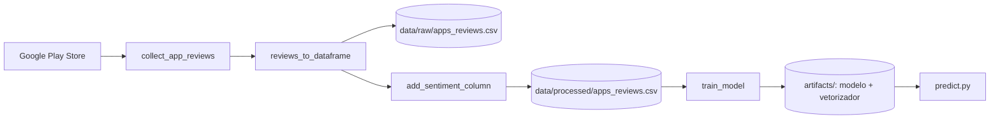

# DeliveryLens AI

Análise de avaliações de aplicativos de delivery com Ciência de Dados, Processamento de Linguagem Natural (NLP) e Machine Learning.

> **Status: versão 1.0 (experimental).** O projeto está em desenvolvimento evolutivo. A V1.0 implementa um pipeline básico de coleta, rotulagem e classificação binária de sentimento, com limitações conhecidas descritas [abaixo](#limitações-conhecidas-e-melhorias-futuras). Não é um produto finalizado nem está pronto para produção.

## Sumário

- [Contexto e objetivo](#contexto-e-objetivo)
- [Funcionalidades da V1.0](#funcionalidades-da-v10)
- [Tecnologias](#tecnologias)
- [Fluxo de funcionamento](#fluxo-de-funcionamento)
- [Estrutura do projeto](#estrutura-do-projeto)
- [Instalação e execução](#instalação-e-execução)
- [Exemplo de predição](#exemplo-de-predição)
- [Resultados experimentais](#resultados-experimentais)
- [Limitações conhecidas e melhorias futuras](#limitações-conhecidas-e-melhorias-futuras)

## Contexto e objetivo

O DeliveryLens AI investiga a experiência de usuários de aplicativos de delivery a partir de avaliações públicas. Nesta versão, os aplicativos analisados são **iFood** e **Rappi**, e as avaliações são coletadas na **Google Play Store**.

O objetivo do projeto é identificar padrões de satisfação e insatisfação e desenvolver mecanismos de classificação de sentimentos. O trabalho se relaciona ao estudo de experiências negativas e ao conceito de *Value Co-Destruction* no contexto de aplicativos de delivery.

**Escopo da V1.0:** o projeto classifica avaliações como positivas ou negativas. Ele **ainda não** identifica automaticamente as causas da insatisfação (atrasos, reembolsos, pedidos incompletos etc.); essa análise faz parte das próximas etapas.

## Funcionalidades da V1.0

**Coleta de dados**
- Coleta de avaliações com `google-play-scraper`, para iFood e Rappi.
- Limite configurado de 100 avaliações por aplicativo, com coleta paginada (páginas de 10 avaliações).
- Registro do identificador do aplicativo (`app_id`) em cada avaliação.

**Preparação e armazenamento**
- Conversão dos registros em `DataFrame` (Pandas).
- Armazenamento dos dados brutos em CSV (`data/raw/`).
- Rotulagem inicial de sentimento a partir da nota:

| Nota | Sentimento |
|------|------------|
| 1 e 2 | Negativo |
| 3 | Neutro |
| 4 e 5 | Positivo |

- Armazenamento separado dos dados processados em CSV (`data/processed/`).

**Machine Learning**
- Exclusão das avaliações neutras no treinamento desta versão.
- Divisão treino/teste de 80/20, com estratificação (`stratify`).
- Representação textual com TF-IDF.
- Classificação com Logistic Regression.
- Avaliação com `classification_report`.
- Persistência do modelo e do vetorizador com Joblib.

**Predição**
- Carregamento dos artefatos salvos.
- Transformação de novos textos com o vetorizador treinado.
- Classificação de avaliações individuais como positivas ou negativas.

> **Sobre os rótulos:** a classificação de sentimento é derivada das **notas** atribuídas pelos usuários. Não há anotação manual ou por especialistas. O modelo aprende padrões textuais associados a esses rótulos, que são uma aproximação do sentimento real.

## Tecnologias

| Tecnologia | Uso no projeto | Versão utilizada |
| [Python](https://www.python.org/) | Linguagem principal | 3.11.9 (ambiente de desenvolvimento) |
| [google-play-scraper](https://github.com/JoMingyu/google-play-scraper) | Coleta de avaliações | 1.2.7 |
| [pandas](https://pandas.pydata.org/) | Manipulação de dados e CSV | 3.1.1 |
| [scikit-learn](https://scikit-learn.org/) | TF-IDF, Logistic Regression, avaliação | 1.9.1 |
| [Joblib](https://joblib.readthedocs.io/) | Persistência do modelo e do vetorizador | 1.6.0 |

O projeto foi desenvolvido no Windows com Python 3.11.9. Outros sistemas e versões de Python não foram testados.

## Fluxo de funcionamento



1. `run_pipeline.py` coleta as avaliações de cada aplicativo e as reúne em um único `DataFrame`.
2. Os dados brutos são salvos em `data/raw/apps_reviews.csv`.
3. A coluna de sentimento é adicionada com base na nota, e o resultado é salvo em `data/processed/apps_reviews.csv`.
4. `train_model` lê o CSV processado, treina e avalia o classificador e salva o modelo e o vetorizador em `artifacts/`.
5. A predição é uma etapa separada: ela **não** é executada por `run_pipeline.py` e usa os artefatos gerados no passo anterior.

## Estrutura do projeto

```text
DeliveryLens-AI/
├── artifacts/            # Modelo e vetorizador gerados (conteúdo ignorado pelo Git)
├── data/
│   ├── raw/              # Dados brutos em CSV (conteúdo ignorado pelo Git)
│   └── processed/        # Dados com sentimento em CSV (conteúdo ignorado pelo Git)
├── src/
│   ├── data/
│   │   └── collector.py
│   └── models/
│       ├── train.py
│       └── predict.py
├── .gitignore
├── README.md
├── requirements.txt
└── run_pipeline.py
```

| Arquivo | Responsabilidade |
|---------|------------------|
| `run_pipeline.py` | Orquestra o fluxo completo: coleta iFood e Rappi, salva dados brutos, adiciona o sentimento, salva dados processados e chama o treinamento. |
| `src/data/collector.py` | Coleta e preparação dos dados: `collect_app_reviews`, `reviews_to_dataframe`, `add_sentiment_column` e `save_reviews_csv`. |
| `src/models/train.py` | Treinamento e avaliação do modelo (`train_model`): TF-IDF, Logistic Regression e persistência com Joblib. |
| `src/models/predict.py` | Carrega os artefatos salvos e classifica novos textos. |

Como `data/raw/`, `data/processed/` e `artifacts/` são ignorados pelo Git, um clone recém-feito **não contém dados nem modelo treinado**. É necessário executar o pipeline antes de usar a predição.

## Instalação e execução

**Requisitos:** Python 3.11.9 (versão usada no desenvolvimento), Git e conexão com a internet. A coleta depende da disponibilidade das avaliações na Google Play Store, e os dados podem variar entre execuções.

```bash
# 1. Clonar o repositório
git clone https://github.com/Miguellsouza/DeliveryLens-AI.git
cd DeliveryLens-AI

# 2. Criar o ambiente virtual
python -m venv .venv

# 3. Ativar o ambiente virtual (Windows)
.venv\Scripts\activate

# 4. Instalar as dependências
pip install -r requirements.txt

# 5. Executar o pipeline (coleta, processamento e treinamento)
python run_pipeline.py
```

Execute os comandos **a partir da raiz do repositório**: os imports (`from src...`) e os caminhos dos arquivos (`data/raw/...`, `data/processed/...`) são relativos a ela.

Se o PowerShell bloquear a ativação do ambiente virtual, execute `Set-ExecutionPolicy -Scope Process -ExecutionPolicy Bypass` na mesma janela e tente novamente.

## Exemplo de predição

Depois de executar o pipeline, a predição usa os artefatos salvos em `artifacts/`:

```python
# Execute a partir da raiz do repositório, com o ambiente virtual ativo
from src.models.predict import predict_sentiment

texto = "O pedido chegou rápido e bem embalado."
resultado = predict_sentiment(texto)
print(resultado)  # Positivo ou Negativo
```

## Resultados experimentais

Os números abaixo vêm de **uma execução experimental específica** da V1.0 e **não representam desempenho garantido** do modelo.

| Item | Valor |
|------|-------|
| Total de avaliações coletadas | 200 |
| iFood | 100 |
| Rappi | 100 |
| Conjunto de teste | 39 avaliações |
| Acurácia | 92% |

| Classe | Precision | Recall | F1-score | Support |
|--------|-----------|--------|----------|---------|
| Negativo | 0.94 | 0.88 | 0.91 | 17 |
| Positivo | 0.91 | 0.95 | 0.93 | 22 |

**Como interpretar esses resultados:**

- A amostra é pequena. Com 39 exemplos no teste, cada classificação incorreta altera a acurácia em cerca de 2,6 pontos percentuais.
- Os rótulos de avaliação são derivados das notas, e não de anotação manual. O modelo é avaliado quanto à sua capacidade de reproduzir esses rótulos.
- O teste foi feito com uma única divisão treino/teste, sem validação cruzada.
- A coleta usa avaliações recentes; os dados mudam entre execuções, e os resultados podem variar.
- Testes exploratórios com textos escritos manualmente apresentaram erros de classificação, o que indica limitações de generalização.

## Limitações conhecidas e melhorias futuras

### Limitações atuais

- Quantidade reduzida de avaliações (200 no total).
- Rótulos de treinamento derivados das notas, sem anotação manual.
- Exclusão da categoria neutra durante o treinamento.
- Capacidade limitada de generalização para textos novos.
- Ausência de validação externa com um conjunto independente de avaliações anotadas.
- Ausência de testes automatizados abrangentes (não há diretório de testes no repositório).
- Ausência de uma análise aprofundada dos motivos das reclamações.

### Possíveis evoluções

Os itens abaixo são planejados e **ainda não estão implementados**.

- Aumentar a base de avaliações.
- Implementar pré-processamento textual mais elaborado.
- Desenvolver classificação em três categorias: positivo, negativo e neutro.
- Investigar categorias de reclamações, como atrasos, reembolsos, atendimento e problemas com pedidos.
- Experimentar outros algoritmos e modelos de NLP.
- Melhorar a avaliação e a validação dos modelos.
- Desenvolver visualizações e dashboards.
- Disponibilizar os resultados por API, futuramente.